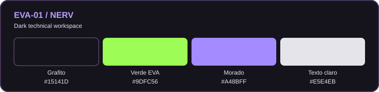

# EVA-01 — Tema para Obsidian

**EVA-01 / NERV**  
*Dark technical workspace*

## Paleta visual



La paleta combina el fondo grafito `#15141D`, el verde EVA `#9DFC56`, el morado `#A48BFF` y el blanco suave `#E5E4EB`.

He creado EVA-01, un tema personalizado para Obsidian basado en tu entorno Ubuntu + KDE Plasma y la estética que utilizas en Kitty, Konsole y el escritorio.

Tema oscuro inspirado en la estación Ubuntu + KDE Plasma EVA-01 del entorno del usuario: superficies grafito-morado, verde eléctrico para acciones y estados activos, morado para enlaces y secciones, y tipografía legible para sistemas y documentación técnica.

## Instalar

1. Cierra Obsidian (o reinícialo al terminar).
2. Copia la carpeta `Obsidian-EVA-01` completa a `<tu_boveda>/.obsidian/themes/EVA-01/` (el nombre final de la carpeta puede ser `EVA-01`).
3. Abre **Ajustes → Apariencia → Temas** y selecciona **EVA-01**. Selecciona el esquema **Oscuro** en Apariencia.

Ejemplo para Linux, ejecutándolo desde el directorio en el que has descomprimido el ZIP:

```bash
mkdir -p "/ruta/a/tu/boveda/.obsidian/themes/EVA-01"
cp Obsidian-EVA-01/{manifest.json,theme.css} "/ruta/a/tu/boveda/.obsidian/themes/EVA-01/"
```

> No modifica otros temas, plugins ni la barra flotante de KDE. No necesita fuentes de pago ni conexiones externas. Si ya tienes instalado **JetBrains Mono** e **Inter**, los usará; si no, emplea alternativas del sistema.

## Personalización rápida

Edita `theme.css` para ajustar estos valores:
- `--interactive-accent`: verde principal `#9dfc56`.
- `--link-color`: morado de enlaces `#b4a2ff`.
- `--background-primary`: fondo central `#15141d`.
- `--file-line-width`: ancho para documentación (`850px`).

## Compatibilidad

Pensado para Obsidian de escritorio (Linux/KDE) y también usable en móvil. El estilo es propio de Obsidian; no modifica temas de KDE, Konsole, Kitty ni aplicaciones ajenas. Algunos plugins con estilos personalizados pueden requerir ajustes adicionales.
